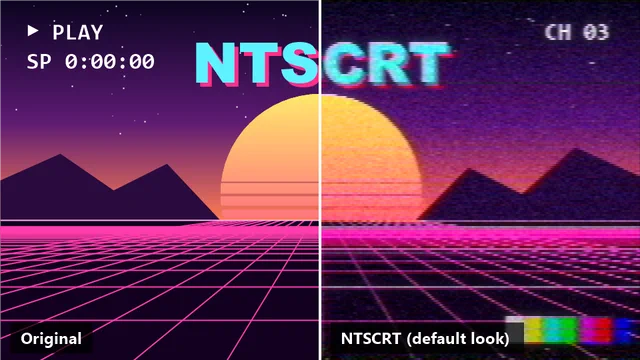
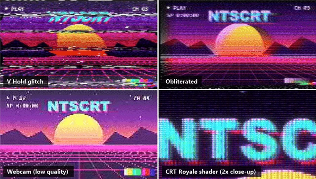

# NTSCRT Plugins

**Make any video look like it came off an old TV, a VHS tape, a CRT screen or an early webcam.**
NTSCRT is a free effect for DaVinci Resolve. Drop it on a clip, pick a look from a menu, and adjust it if you
like. It brings the look of the [NTSCRT](https://github.com/finnmckenty/NTSCRT) app by Finn McKenty into your
video editor.


*Before / after with the default look, in motion: colour bleeding, moving noise, scan lines and screen glow.*


*A few of the bundled looks and TV-screen styles. Both animations were made by the plug-in itself, in Resolve.*

**[See every look in the Presets gallery](docs/PRESETS-GALLERY.md)**: an animated preview of each preset.

Free and open source under the [MIT licence](#licence).

**On this page:** [What you need](#what-you-need) · [Install](#install) · [Update or remove it](#update-or-remove-it) ·
[Use it in Resolve](#use-it-in-resolve) · [What you can do](#what-you-can-do) · [Tips](#tips) ·
[Something's wrong?](#somethings-wrong) · [Credits](#credits) · [Licence](#licence) ·
[For developers and technical details](#for-developers-and-technical-details)

## What you need

| | |
|---|---|
| **Editing app** | DaVinci Resolve **21.1.2 or newer**. The free version and Studio both work. Older versions aren't tested. |
| **Windows** | Windows 10 or 11 (64-bit). Any graphics card from the last ten years. |
| **Mac** | macOS 12 Monterey or newer. Apple silicon (M1 and later) or Intel. |
| **Internet** | Needed while installing: the installer downloads the plug-in. |

**Final Cut Pro: coming later, not available yet.** A Final Cut Pro version (for Final Cut Pro 12.4 and newer)
is being written, but it hasn't been built or tested yet, and the downloads don't include it. This page mentions
Final Cut only where it will matter once it's out.

## Install

1. **Quit DaVinci Resolve.**
2. Go to the [latest release page](https://github.com/anthonymendez/NTSCRT-Plugins/releases/latest) and
   download the installer for your computer (under *Assets*):
   - **Windows:** `NTSCRT-Installer-windows.msi`
   - **Mac:** `NTSCRT-Installer-macos.pkg`
3. Double-click the file you downloaded and follow the steps.
4. Start Resolve again.

The installer is small: it downloads the newest version of the plug-in while it runs. So even an old installer
gets you the latest version.

**"Windows protected your PC" or "can't be opened"?** The installer isn't signed with a Microsoft or Apple
certificate yet, so the first time it needs one extra click. This is expected.

- **Windows:** click **More info**, then **Run anyway**. Then click **Yes** when Windows asks for permission.
- **Mac:** open **System Settings → Privacy & Security**, scroll down and click **Open Anyway** next to the
  NTSCRT message. Then open the installer again and enter your Mac password when asked.

Prefer typing one line into PowerShell or Terminal instead? See [Install with one line](#install-with-one-line).

## Update or remove it

**Update:** quit Resolve and run the installer again. It always installs the newest version. On Windows you can
also use **Update NTSCRT plug-in** in the Start menu. Your projects keep their effects and settings. To see which
version you have, look at **Presets → Version** in the effect's settings. To see what's new, read the
[list of changes](CHANGELOG.md).

**Remove (uninstall):**

- **Windows:** open **Settings → Apps**, find **NTSCRT plug-in installer** and click **Uninstall**. This removes
  the plug-in too.
- **Mac:** open the **Terminal** app, paste this line and press Return, then enter your password when asked:

  ```bash
  curl -fsSL https://raw.githubusercontent.com/anthonymendez/NTSCRT-Plugins/main/install.sh | sh -s -- --uninstall
  ```

## Use it in Resolve

1. Open the **Effects** panel and go to **OpenFX → Filters → NTSCRT**.
2. Drag **NTSCRT** onto a clip in the timeline, or onto a node on the Color page.
3. Select the clip and open the **Inspector** to see the effect's settings.
4. At the top, under **Presets**, choose a look from the **Preset** menu. Then change anything you like.

You can keyframe (animate) any setting, as with other Resolve effects.

## What you can do

**Start with a preset.** The **Preset** menu has ready-made looks, for example *Clean VHS*, *Medium VHS*,
*V Hold glitch*, *Obliterated* and *Webcam*. Choosing one sets all the look's settings at once (and clears their
keyframes; Undo brings them back). Then fine-tune anything.

- **Animated looks** such as *Glitch pop* and *15 second glitches* add keyframes that make glitches come and go,
  repeating over the clip.
- **Digital video/…** entries (Webcam (2005), Video call, MiniDV, Early web video, CD-ROM (Video 1),
  Datamosh) give the clip the look of an old digital camera or internet video. They only change the digital
  video settings and the picture size, and leave the rest of your look alone.
- **Screen Loop preset** adds a "camcorder filming its own TV" effect: copies of the picture inside itself.

Every preset is shown in the **[Presets gallery](docs/PRESETS-GALLERY.md)**.

**The main sections of settings**, in plain terms:

| Section | What it does to the picture |
|---|---|
| **Crop** | Crops the picture to another shape (for example 4:3, like an old TV). |
| **Downscale** | Makes the picture low-resolution, like old game consoles, computers or VHS. **Horizontal resolution** has ready-made sizes (SNES 256, VGA 320, Arcade 384, …); type your own width for *Custom*. |
| **Digital video** | Early digital video: blocky compression, low frame rates, noisy webcam sensors, datamosh smears. |
| **NTSC (TV)** | The analog TV and VHS look: colours bleeding sideways, fuzzy noise, ghostly outlines, the wobbly band at the bottom of a VHS tape, wavy edges. |
| **Glitch** | A misbehaving TV or VCR: weak reception and snow, a rolling picture, ghosts, hum bars, tape crinkles, dropouts, tracking errors. |
| **CRT** | The glass TV screen: scan lines, the glow of a tube screen, the pattern of tiny red, green and blue dots. Choose a screen style in **CRT → Shader** (Aperture, Easymode, Glow, Hyllian, Royale, Sim). |
| **Screen Loop** | Video feedback: a camcorder pointed at the TV showing its own picture, with zoom, drift, handheld shake and colour drift. |
| **Transparency** | For titles and clips that don't fill the frame (see [Tips](#tips)). |

**Save and load your own looks.** **Save preset…** saves the current look (as it is at the playhead) to a file;
**Load preset…** opens one. These files also work in the NTSCRT app.

Switch every section off and the effect leaves the clip exactly as it was.

## Tips

- **Apply it to clips at their own size.** On a small (low-resolution) clip in a big timeline, the effect gets
  scaled up together with the picture.
- **Titles and logos:** use **Transparency → Transparent areas**. *Clip to element* (the default) keeps the effect
  inside the title's shape with clean edges. *Let effect spill* lets ghosting and glow spread over the video
  underneath. Presets don't change this setting.
- **The first frame after a jump can be slow.** With Digital video or Screen Loop on, the effect needs the frames
  before the one you're looking at, so jumping far into a clip takes a moment. After that it's quick.
- **Animated presets don't follow later changes.** If you change the clip's length or frame rate after choosing an
  animated preset, choose the preset again.
- **Many copies of the effect use a lot of memory.** Each NTSCRT effect can keep up to about half a gigabyte of
  frames in memory. If Resolve slows down, use fewer copies (for example one on an Adjustment Clip).
- **Slow renders?** The effect is fastest on Windows with an NVIDIA graphics card. Other graphics cards and Macs
  work too, just more slowly. On a Windows PC without a suitable graphics card it falls back to a slow software
  mode. Digital video, Screen Loop and the heaviest screen style (*Sim*) cost the most.

## Something's wrong?

| Problem | What to do |
|---|---|
| NTSCRT isn't in the Effects panel | Quit Resolve completely and start it again. If it's still missing, run the installer again. |
| Resolve skipped the plug-in when it started | Resolve turns off plug-ins that crashed. Turn it back on in **Preferences → Video Plugins**, and please [report it](#report-a-problem) with the log. |
| Installer says "Couldn't replace the installed plugin" | Resolve is still using it. Quit Resolve completely (check the system tray and Task Manager) and run the installer again. Your old version stays installed until then. |
| Folders named `NTSCRT.ofx.bundle.old-…` appear | These are the previous version, kept while Resolve still had it open. Resolve ignores them, and the next install removes them. |
| Mac says "NTSCRT.ofx is damaged" or "can't be verified" | Run the installer (or the [install line](#install-with-one-line)) again. |
| A warning says the CRT shader is "unavailable" | Part of the plug-in is missing, usually after an interrupted copy. The effect keeps working without the screen style. Run the installer again. |
| The picture is black, or unchanged | If Resolve shows an error message from the effect, please [report it](#report-a-problem). If every section is switched off, the clip is meant to look unchanged. |
| A warning about non-square pixels | The clip is anamorphic (stored squeezed). The effect treats it as normal, so the result looks squeezed or stretched. Use regular (square-pixel) footage for NTSCRT clips. |
| Resolve uses a lot of memory | See the memory tip under [Tips](#tips). |

More fixes for technical problems are in [Technical troubleshooting](#technical-troubleshooting).

### Report a problem

1. Select the effect. In its **Presets** section, tick **Debug logging**.
2. Play or render the frames that look wrong.
3. Untick **Debug logging** (it slows rendering a little).
4. Click **Open logs folder** and attach the file `ntscrt-ofx.log` to your report.

If the problem isn't tied to one clip, click **Turn on debug logging for all effects** instead, and click it
again when you're done. The log file lives here:

- Windows: `%LOCALAPPDATA%\NTSCRT\ntscrt-ofx.log`
- Mac: `~/Library/Logs/NTSCRT/ntscrt-ofx.log`

Then [open an issue](https://github.com/anthonymendez/NTSCRT-Plugins/issues/new/choose) (a short form on GitHub)
and attach the log. The [testing guide](docs/TESTING.md) has a 10-minute check and a tool, `ntscrt_doctor.py`,
that collects everything for a report. Found a security problem? Please report it privately: see
[SECURITY.md](SECURITY.md).

## Credits

All of the look comes from [NTSCRT](https://github.com/finnmckenty/NTSCRT) by Finn McKenty (MIT),
[ntsc-rs](https://github.com/ntsc-rs/ntsc-rs) (MIT/ISC/Apache-2.0),
[librashader](https://github.com/SnowflakePowered/librashader) (MPL-2.0) and the
[libretro slang-shaders](https://github.com/libretro/slang-shaders) authors (various licences, largely GPL).

## Licence

The plug-ins' own code is under the [MIT licence](LICENSE), Copyright (c) 2026 Anthony Mendez, and
Copyright (c) 2026 Finn McKenty for the NTSCRT code it is ported from.

Bundled third-party components keep their own licences: see [THIRD_PARTY_NOTICES.md](THIRD_PARTY_NOTICES.md)
and [licenses/](licenses/). In particular, librashader (MPL-2.0) is a separate library file and the
RetroArch CRT shaders (several under the GPL) are separate shader source files, both shipped unmodified next
to the MIT plug-in; their licences cover those files only. The same notices ship inside every bundle
(`Contents/Resources/`).

---

## For developers and technical details

Everything below is for testers, developers and anyone who wants the details. You don't need it to use the
plug-in.

More documents: [what changed](CHANGELOG.md) · [testing guide and bug reports](docs/TESTING.md) ·
[environment variables](docs/ENVIRONMENT.md) · [parameters, looks and preset format](docs/params.md) ·
[contributing](CONTRIBUTING.md) · [security](SECURITY.md) · [releasing](docs/RELEASING.md) ·
[licence](LICENSE) and [third-party notices](THIRD_PARTY_NOTICES.md).

### What's inside

NTSCRT's analog TV look (ntsc-rs signal emulation, TV/VCR glitch circuits, RetroArch CRT shaders via
librashader, digital codec, Screen Loop) as video-editor effects:

- **DaVinci Resolve 21.1.2+**: OpenFX plugin, Windows and macOS. Released.
- **Final Cut Pro 12.4+**: FxPlug 4 plugin, macOS. **Not released yet:** the code is in `fxplug/`, but it
  hasn't been built or tested in Final Cut (CI builds it only when an FxPlug SDK is configured, see
  [fxplug/README.md](fxplug/README.md)), and releases don't include it. The Final Cut parts of this page apply
  once a release does.

Synced with upstream NTSCRT v0.21.0.

| App | Supported |
|---|---|
| DaVinci Resolve (Windows) | 21.1.2 and later (free or Studio), x64 |
| DaVinci Resolve (macOS) | 21.1.2 and later (free or Studio), Apple silicon + Intel |
| Final Cut Pro (macOS) | not released yet (planned: 12.4 and later) |

The preview animations at the top are rendered by the Resolve plug-in itself (DaVinci Resolve running headless)
with `scripts/make_previews_resolve.py`; `scripts/make_previews.ps1` makes the same animations through
`ntscrt-cli` when Resolve isn't available. The gallery comes from `scripts/make_presets_gallery.py`
([how the gallery images were made](docs/PRESETS-GALLERY.md#how-these-images-were-made)).

### Detailed requirements

- **Windows:** Windows 10 or 11 (tested on 11), x64, with a Direct3D 11 GPU (feature level 11.0; any GPU from the
  last ten years). Without one the plug-in falls back to Windows' software renderer (WARP), which works but is slow.
- **macOS:** macOS 12 Monterey or later, Apple silicon or Intel, with a Metal GPU (every Mac that runs macOS 12).
- **DaVinci Resolve 21.1.2 or later.** Older versions aren't tested.
- The installers need an internet connection (they download the latest release from GitHub).

### Install with one line

**Windows** (PowerShell): installs the DaVinci Resolve plugin

```powershell
irm https://raw.githubusercontent.com/anthonymendez/NTSCRT-Plugins/main/install.ps1 | iex
```

**macOS** (Terminal): installs for DaVinci Resolve (and Final Cut Pro once a release includes it)

```bash
curl -fsSL https://raw.githubusercontent.com/anthonymendez/NTSCRT-Plugins/main/install.sh | sh
```

Accept the admin prompt (Windows) or enter your password (macOS), then start the app:

- **Resolve**: *Effects → OpenFX → Filters → NTSCRT*. Drag it onto a clip, or into a node on the Color page.
- **Final Cut Pro** (once released): *Effects browser → NTSCRT*. Drag it onto a clip, then adjust it in the Video
  Inspector. Keep `/Applications/NTSCRT.app`: the plug-in lives inside it.

The scripts download the latest release, install it, and clear the macOS download quarantine. Re-run the
same line to update: it installs the latest release over the old one and prints both versions. You can read
them first: [install.ps1](install.ps1), [install.sh](install.sh).

**Options**

| | Windows (`install.ps1`) | macOS (`install.sh`) |
|---|---|---|
| Uninstall | `-Uninstall` | `--uninstall` |
| Specific release | `-Version vX.Y.Z` | `--version vX.Y.Z` |
| Only one app | (Resolve only on Windows) | `--resolve` or `--fcp` |
| Install a zip you downloaded | `-From path\to.zip` | `--from path/to.zip` |

`-Version` / `--version` take `latest` (the default) or a tag like `v1.2.3`.

Passing options to a one-liner:

```powershell
& ([scriptblock]::Create((irm https://raw.githubusercontent.com/anthonymendez/NTSCRT-Plugins/main/install.ps1))) -Uninstall
```

```bash
curl -fsSL https://raw.githubusercontent.com/anthonymendez/NTSCRT-Plugins/main/install.sh | sh -s -- --fcp
```

**Checksums.** The scripts check each download against the release's `SHA256SUMS` file and refuse to install a
zip that isn't listed in it or doesn't match (or a release with no `SHA256SUMS`). The only exceptions are v0.3.0
and v0.4.0, published before checksums existed: they install with a warning, without verification; every later
release is verified. `-From` / `--from` with your own zip skips the check.

**Release candidates** (`vX.Y.Z-rc.N` tags, marked *Pre-release* on the releases page) are for testers:
the installers and `latest` skip them. Install one with `-Version` / `--version` and its tag (for example
`v1.2.0-rc.1`); run the install line again without it to go back to the latest release.

<details><summary>Manual install from the zip (no scripts)</summary>

Download from the repo's **Releases** page: `NTSCRT-OFX-windows-x64.zip`, `NTSCRT-OFX-macos-universal.zip`
or `NTSCRT-FxPlug-macos-universal.zip` (once a release includes it).

- **Resolve on Windows:** unzip, then double-click **`Install NTSCRT.cmd`**, or copy the `NTSCRT.ofx.bundle`
  folder into `C:\Program Files\Common Files\OFX\Plugins\` yourself.
- **Resolve on macOS:** unzip, copy `NTSCRT.ofx.bundle` into `/Library/OFX/Plugins/`, then run
  `sudo xattr -dr com.apple.quarantine /Library/OFX/Plugins/NTSCRT.ofx.bundle`.
- **Final Cut Pro:** unzip, drag `NTSCRT.app` into Applications and open it once. It registers the plug-in,
  installs the effect template, then quits. If macOS says it "can't be opened" (builds aren't notarized
  yet), click **Open Anyway** in *System Settings → Privacy & Security* and open it again.
- **Uninstall by hand:** delete the `NTSCRT.ofx.bundle` you copied. For Final Cut Pro, delete
  `/Applications/NTSCRT.app` and `~/Movies/Motion Templates.localized/Effects.localized/NTSCRT`.

</details>

### Verify a release download

Each release has the zips, the two installers and a **`SHA256SUMS`** file (SHA-256 of every other asset). Every
asset also has a signed build provenance attestation (`actions/attest-build-provenance`) saying which workflow
run and commit built it. To check a download:

```bash
sha256sum -c SHA256SUMS --ignore-missing                       # macOS: shasum -a 256 -c SHA256SUMS
gh attestation verify NTSCRT-OFX-windows-x64.zip -R anthonymendez/NTSCRT-Plugins
```

Details: [docs/RELEASING.md](docs/RELEASING.md#what-a-release-contains-and-how-to-check-it).

### Technical notes on using it

- **Presets** set every look control and remove their keyframes (undo brings them back). Animated looks arrive
  as keyframes that play the NTSCRT app's animation from the clip's first frame, looping until its end. The
  **Digital video/…** entries are upstream's digital formats: they switch Digital video on and set its controls
  and the Downscale width, leaving the rest of the look alone.
- **Preset files** (*Load preset… / Save preset…*) are the same JSON as the NTSCRT app, and the NTSC section is
  compatible with ntsc-rs presets. Save writes the look at the playhead (keyframes aren't saved). Saved files also
  carry the Screen Loop settings (and, while Screen Loop is on, a second file `<name> (Screen Loop).json` for the
  NTSCRT app). Presets saved by older versions load as they looked. Format: [docs/params.md](docs/params.md).
- **Pass-through:** with every stage switched off (Crop, Downscale, Digital video, NTSC, Glitch, CRT, Screen
  Loop) the effect passes the clip through untouched.
- **16-bit and float projects** get the CRT shader's output at half-float precision, so its glow and gradients
  don't band when graded afterwards. The stages before the CRT shader work at 8 bits per channel.
- **Let effect spill** shows the spill as light over the video underneath (like a Screen blend).
- Screen Loop and the Digital-video codec depend on earlier frames, so the first render after jumping far into a
  clip can take a moment.

### Known issues and limitations

- **Animated presets are keyframed, not linked.** Choosing *Glitch pop*, *15 second glitches* and the other
  animated looks writes their animation as keyframes (where each moving control's curve bends), looping from
  the clip's first frame, for whole loops around the playhead: as many as about 3000 keyframes allow, at most
  3600 frames (the first / last values hold outside them; on a long clip, choose the preset again further on
  to key there). Changing the clip's length or frame rate later doesn't re-time them: choose the preset again.
  On an Adjustment Clip Resolve doesn't say where the clip starts: the loop is in step with the timeline's
  frame 0 instead.
- **Glitch's simulated TV restarts every minute** of an effect (a minute of timecode): a rolling picture
  (Vertical hold off centre) can jump at those boundaries. It keeps frames and edits fast however far into
  the timeline they are.
- **Save preset…** saves the look at the playhead, not the animation.
- **Seeks can take a moment** with Digital video or Screen Loop on: they depend on earlier frames, so after
  a jump the plug-in renders those first (Digital video back to its last keyframe, Screen Loop over its
  length; a jump back near frames it already rendered resumes from the loop's checkpoint at most 30 frames
  earlier). After a Glitch edit, the Glitch simulation runs again from the clip's first frame.
- **Memory:** each effect keeps up to 512 MB of recent source frames (`NTSCRT_SOURCE_CACHE_MB` changes it,
  see [docs/ENVIRONMENT.md](docs/ENVIRONMENT.md)), and with Screen Loop on up to 256 MB of GPU memory for the
  loop's checkpoints (`NTSCRT_SCREENLOOP_CHECKPOINT_MB`), which adds up with many instances.
- **8 bits before the CRT shader, no HDR:** every stage before the CRT shader works at 8 bits per channel, and
  values above 1.0 (HDR, super-whites) are clipped. On 16-bit / float timelines only the CRT shader's output is
  half-float; with the CRT shader off, or without a GPU, the output is 8-bit, so heavy grading on top can show
  banding.
- **Speed: which GPUs get what.** On Windows the NTSC signal runs on the GPU (the same pictures as ntsc-rs, bit
  for bit), so the default look costs about as much as *Clean CRT*. With an **NVIDIA GPU** Resolve's frames also
  stay on the GPU: a 300-frame UHD render of the default look takes ~2.8 s on an RTX 5090 (~2.4 s without the
  effect; 0.5.0-rc.4: ~18 s), nothing goes through the CPU unless Digital video or Screen Loop need the picture.
  With **AMD or Intel GPUs** (Resolve's OpenCL mode) Resolve hands the effect CPU frames: the NTSC signal still
  runs on the GPU, but each frame goes to the GPU and back (~8 s for the same UHD render, measured with
  `NTSCRT_OFX_GPU=0` on the RTX 5090; AMD and Intel GPUs themselves haven't been measured yet, and a GPU that
  fails the plug-in's exactness check uses ntsc-rs). On **macOS** and without a GPU (Windows' software
  renderer) the NTSC signal runs on ntsc-rs on the CPU (~50 ms per UHD frame, ~13 ms at 1080p, on a 16-core CPU).
  `NTSCRT_NTSC_GPU=0` (ntsc-rs everywhere) and `NTSCRT_OFX_GPU=0` (CPU frames) turn either off
  ([docs/ENVIRONMENT.md](docs/ENVIRONMENT.md); details and measurements in
  [docs/dev/NTSC-GPU.md](docs/dev/NTSC-GPU.md) and [docs/dev/HOST-GPU.md](docs/dev/HOST-GPU.md); see also
  [docs/dev/DIGITAL-GPU.md](docs/dev/DIGITAL-GPU.md), [docs/dev/CRT.md](docs/dev/CRT.md) and
  [docs/dev/SCREENLOOP-MEMORY.md](docs/dev/SCREENLOOP-MEMORY.md)). The debug log says which route each effect and
  frame took ([docs/TESTING.md](docs/TESTING.md#debug-logging-for-a-specific-problem)).
- **Non-square pixels** (anamorphic media) are processed as square, with a warning on the effect.
- **Installers aren't code-signed or notarized** yet (see the extra click under [Install](#install)).
- **macOS:** the CI runs on a virtual GPU, so the heaviest CRT shader (*sim*) hasn't been run on real Mac
  hardware yet. Reports welcome ([docs/TESTING.md](docs/TESTING.md)).
- **Final Cut Pro:** not released (see [What's inside](#whats-inside)).

### Technical troubleshooting

[docs/TESTING.md](docs/TESTING.md) has a manual check and a `ntscrt_doctor.py` command that collects a debug
report (logs, install state, optional automatic tests); the bug form asks for that report.

| Problem | Fix |
|---|---|
| Installer says "Couldn't replace the installed plugin" | A file in the plugin is in use. Quit Resolve completely (check the system tray and Task Manager) and run it again. The installed version is left untouched. Installing with Resolve open normally works; the new version loads on the next restart. |
| Effect doesn't show up in Resolve | Restart Resolve fully. Check that the bundle is in the OFX folder (see the manual install above) and that its whole folder was copied (`Contents\Win64\NTSCRT.ofx` on Windows, `Contents/MacOS/NTSCRT.ofx` on macOS). |
| macOS: "NTSCRT.ofx is damaged / can't be verified" | Run the install line again: it clears the quarantine. For a manual copy, run the `xattr` command above. |
| Final Cut: effect missing | Open `/Applications/NTSCRT.app` once more and restart Final Cut. In Terminal, `pluginkit -mAvvv -p FxPlug` should list `NTSCRT Renderer`. |
| Need a log for a bug report | Besides **Debug logging** / **Turn on debug logging for all effects** ([Report a problem](#report-a-problem)), run `ntscrt_doctor.py` ([docs/TESTING.md](docs/TESTING.md)), which collects it for you. Final Cut's log is `ntscrt-fxplug.log`. `NTSCRT_DEBUG_LOG=1` turns on logging for all effects for one session ([docs/ENVIRONMENT.md](docs/ENVIRONMENT.md)). |
| Warning "CRT shader '…' unavailable, showing the picture without it" | The CRT shader couldn't load, usually because of a partial copy (the `shaders/` folder or `librashader` file inside the bundle is missing). The effect keeps rendering without the shader and gives the reason once, as a warning on the effect and in the log. Run the install line again. |
| Picture is black or unchanged | Resolve shows the plug-in's error message when it can't render; send us the log. With every stage off the effect passes the clip through on purpose. |
| Resolve uses a lot of memory | Each NTSCRT effect keeps up to 512 MB of recent source frames for Digital video and Screen Loop. Fewer instances, or a smaller budget with the `NTSCRT_SOURCE_CACHE_MB` environment variable ([docs/ENVIRONMENT.md](docs/ENVIRONMENT.md)), help. |

### Environment variables

The plug-in, the core, the installers and the scripts read a few environment variables (log location, GPU
routes, memory budgets, debug logging). All of them are listed in [docs/ENVIRONMENT.md](docs/ENVIRONMENT.md).

### Build from source

You need CMake 3.24+ (4.x works), Rust stable (`rustup`), Python 3, Git, and the submodules:

```text
git clone --recursive https://github.com/anthonymendez/NTSCRT-Plugins.git
cd NTSCRT-Plugins
```

(or `git submodule update --init --depth 1` in an existing clone). Other dependencies (OpenFX SDK,
nlohmann/json, stb, doctest, the Slang compiler) are downloaded at configure time.

#### Windows

Visual Studio 2022 (or its Build Tools) with the C++ workload. Use a **short build folder** such as
`C:\build\ntscrt`: deep paths break MSBuild and the Rust builds.

```text
cmake -S . -B C:/build/ntscrt -G "Visual Studio 17 2022" -A x64
cmake --build C:/build/ntscrt --config Release -- -m
ctest --test-dir C:/build/ntscrt -C Release
```

The plug-in is `C:/build/ntscrt/ofx/Release/NTSCRT.ofx.bundle`: copy it into
`C:\Program Files\Common Files\OFX\Plugins\` and restart Resolve.

#### macOS

Xcode 15 or later (or its Command Line Tools), CMake, and both Rust targets for a universal build:

```text
rustup target add aarch64-apple-darwin x86_64-apple-darwin
cmake -S . -B build -DCMAKE_BUILD_TYPE=Release "-DCMAKE_OSX_ARCHITECTURES=arm64;x86_64"
cmake --build build --parallel "$(sysctl -n hw.ncpu)"
ctest --test-dir build --output-on-failure
```

The plug-in is `build/ofx/Release/NTSCRT.ofx.bundle`: copy it into `/Library/OFX/Plugins/` and restart Resolve.
Leave out `CMAKE_OSX_ARCHITECTURES` to build for your Mac only. The Final Cut plug-in needs Apple's FxPlug SDK:
see [fxplug/README.md](fxplug/README.md).

### Project layout

| Path | What's there |
|---|---|
| `core/` | The shared renderer: pipeline stages (`core/stages/stages.h` lists them and their per-frame order), GPU backends (Direct3D 11, Metal), the parameter schema (`core/params/schema.json`) |
| `ofx/` | The DaVinci Resolve OpenFX plug-in |
| `fxplug/` | The Final Cut Pro FxPlug plug-in (not released; [fxplug/README.md](fxplug/README.md)) |
| `hostparams/` | One parameter model for both plug-ins ([docs/params.md](docs/params.md#one-model-for-both-plug-ins-hostparams)) |
| `rust/` | The C API around ntsc-rs |
| `presets/` | The bundled presets (NTSCRT app JSON) |
| `tools/` | `ntscrt-cli` (renders looks without an editor) and the schema generator |
| `installer/` | The Windows MSI and the macOS pkg |
| `scripts/` | Release, upstream sync, previews and gallery, and `ntscrt_doctor.py` |
| `tests/` | doctest suites per area, golden images, tests inside Resolve |
| `upstream/`, `vendor/` | Upstream NTSCRT (read-only submodule) and vendored sources such as the slang shaders |

### Tests

- `ctest` runs the doctest suites (see the build commands above).
- [tests/golden/README.md](tests/golden/README.md): golden-image comparisons against upstream NTSCRT's own
  renders and against committed self-references.
- [tests/resolve/README.md](tests/resolve/README.md): tests inside a running DaVinci Resolve Studio.
- [docs/TESTING.md](docs/TESTING.md): manual checks, automatic tests and debug reports on your own machine.

### Upstream sync

The core is a port of [NTSCRT](https://github.com/finnmckenty/NTSCRT), pinned as the read-only submodule
`upstream/NTSCRT`. Bringing in a later upstream release (scripts, port map, CI checks):
[docs/dev/UPSTREAM-SYNC.md](docs/dev/UPSTREAM-SYNC.md).

### Contributing and releasing

Contributing: [CONTRIBUTING.md](CONTRIBUTING.md). Releasing: [docs/RELEASING.md](docs/RELEASING.md).
Bugs and requests: [open an issue](https://github.com/anthonymendez/NTSCRT-Plugins/issues/new/choose).
Security problems: [SECURITY.md](SECURITY.md).
