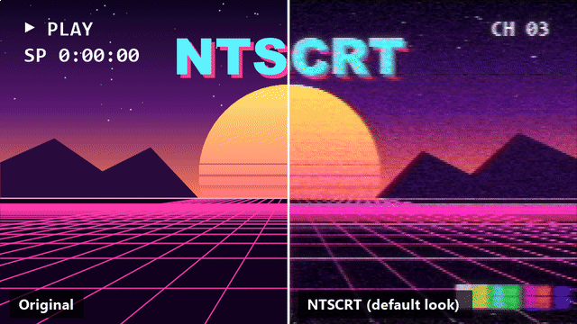

# NTSCRT Plugins

[NTSCRT](https://github.com/finnmckenty/NTSCRT)'s analog TV look (ntsc-rs signal emulation, TV/VCR glitch
circuits, RetroArch CRT shaders via librashader, digital codec, Screen Loop) as video-editor effects:

- **DaVinci Resolve 21.1.2+** — OpenFX plugin, Windows and macOS
- **Final Cut Pro 12.4+** — FxPlug 4 plugin, macOS

Status: in development. See `docs/` for architecture and contracts. Synced with upstream NTSCRT v0.20.0.


*Before / after with the default look, in motion: chroma bleed, moving noise, scanlines and CRT glow.*


*A few of the bundled looks and CRT shaders. Both animations are rendered by the Resolve plug-in itself
(DaVinci Resolve running headless) with `scripts/make_previews_resolve.py`; `scripts/make_previews.ps1`
makes the same GIFs through `ntscrt-cli` when Resolve isn't available.*

## Install

| App | Supported |
|---|---|
| DaVinci Resolve (Windows) | 21.1.2 and later, x64 |
| DaVinci Resolve (macOS) | 21.1.2 and later, Apple silicon + Intel |
| Final Cut Pro (macOS) | 12.4 and later, Apple silicon + Intel |

**Quit DaVinci Resolve / Final Cut Pro first.**

### Download the installer

From the [latest release](https://github.com/anthonymendez/NTSCRT-Plugins/releases/latest):

- **Windows:** `NTSCRT-Installer-windows.msi` (DaVinci Resolve)
- **macOS:** `NTSCRT-Installer-macos.pkg` (DaVinci Resolve and/or Final Cut Pro, whichever you have)

Double-click it and follow the steps. The installer is small: when it runs it downloads the **latest release**
from GitHub and installs that, so an old installer still gets you the newest plug-in (it needs an internet
connection).

The installers aren't signed yet, so the first run needs one extra click:

- **Windows:** if SmartScreen says "Windows protected your PC", click **More info → Run anyway**. Then accept the
  admin prompt.
- **macOS:** if it says the package "can't be opened" / is from an unidentified developer, open
  *System Settings → Privacy & Security*, scroll down and click **Open Anyway** next to the NTSCRT message, then
  open the package again. Enter your password when asked.

**Updating:** run the installer again, or on Windows use **Update NTSCRT plug-in** in the Start menu. Both
install the latest release.
**Uninstalling:** Windows: remove *NTSCRT plug-in installer* in *Settings → Apps* (this removes the plug-in too).
macOS: the `--uninstall` line below.

### Or paste one line

**Windows** (PowerShell): installs the DaVinci Resolve plugin
```powershell
irm https://raw.githubusercontent.com/anthonymendez/NTSCRT-Plugins/main/install.ps1 | iex
```

**macOS** (Terminal): installs for DaVinci Resolve and/or Final Cut Pro, whichever you have
```bash
curl -fsSL https://raw.githubusercontent.com/anthonymendez/NTSCRT-Plugins/main/install.sh | sh
```

Accept the admin prompt (Windows) or enter your password (macOS), then start the app:

- **Resolve**: *Effects → OpenFX → Filters → NTSCRT*. Drag it onto a clip, or into a node on the Color page.
- **Final Cut Pro**: *Effects browser → NTSCRT*. Drag it onto a clip, then adjust it in the Video Inspector.
  Keep `/Applications/NTSCRT.app`: the plug-in lives inside it.

The scripts download the latest release, install it, and clear the macOS download quarantine. Re-run the
same line to update. You can read them first: [install.ps1](install.ps1), [install.sh](install.sh).

**Options**

| | Windows (`install.ps1`) | macOS (`install.sh`) |
|---|---|---|
| Uninstall | `-Uninstall` | `--uninstall` |
| Specific release | `-Version v0.3.0` | `--version v0.3.0` |
| Only one app | (Resolve only on Windows) | `--resolve` or `--fcp` |
| Install a zip you downloaded | `-From path\to.zip` | `--from path/to.zip` |

Passing options to a one-liner:
```powershell
& ([scriptblock]::Create((irm https://raw.githubusercontent.com/anthonymendez/NTSCRT-Plugins/main/install.ps1))) -Uninstall
```
```bash
curl -fsSL https://raw.githubusercontent.com/anthonymendez/NTSCRT-Plugins/main/install.sh | sh -s -- --fcp
```

<details><summary>Manual install from the zip (no scripts)</summary>

Download from the repo's **Releases** page: `NTSCRT-OFX-windows-x64.zip`, `NTSCRT-OFX-macos-universal.zip`
or `NTSCRT-FxPlug-macos-universal.zip`.

- **Resolve on Windows:** unzip, then double-click **`Install NTSCRT.cmd`**, or copy the `NTSCRT.ofx.bundle`
  folder into `C:\Program Files\Common Files\OFX\Plugins\` yourself.
- **Resolve on macOS:** unzip, copy `NTSCRT.ofx.bundle` into `/Library/OFX/Plugins/`, then run
  `sudo xattr -dr com.apple.quarantine /Library/OFX/Plugins/NTSCRT.ofx.bundle`.
- **Final Cut Pro:** unzip, drag `NTSCRT.app` into Applications and open it once. It registers the plug-in,
  installs the effect template, then quits. If macOS says it "can't be opened" (builds aren't notarized
  yet), click **Open Anyway** in *System Settings → Privacy & Security* and open it again.
- **Uninstall by hand:** delete the `NTSCRT.ofx.bundle` you copied. For Final Cut Pro, delete
  `/Applications/NTSCRT.app` and `~/Movies/Motion Templates.localized/Effects.localized/NTSCRT`.
</details>

### Updating
Run the installer or the same install line again (on Windows, also **Update NTSCRT plug-in** in the Start
menu): it installs the latest release over the old one and prints both versions.
Your projects keep their effects and settings. See what changed in [CHANGELOG.md](CHANGELOG.md). In Resolve, the
installed version shows in the effect's **Presets → Version** field. A specific version: `-Version v0.3.0`
(Windows) or `--version v0.3.0` (macOS).

### Using it

- **Preset** menu: pick a look (Clean VHS, Medium VHS, V Hold glitch, Webcam…). It sets every control, and you can
  then tweak and keyframe any of them.
- **Screen Loop preset**: video feedback (a camcorder filming its own TV).
- **Load preset… / Save preset…**: preset files are the same JSON as the NTSCRT app, and the NTSC section is
  compatible with ntsc-rs presets.
- Apply it to the clip at its **native resolution**. On a low-res clip in a high-res timeline, the analog artifacts get
  scaled up with the picture.
- **Titles and clips that don't fill the frame**: *Transparency → Transparent areas* picks how the effect treats
  the empty parts. **Clip to element** (default) keeps the effect inside the element's shape with clean
  edges. **Let effect spill** lets ghosting, smear and glow extend past it, shown as light over the video
  underneath (like a Screen blend). Presets don't change this setting.
- Screen Loop and the Digital-video codec depend on earlier frames, so the first render after jumping far
  into a clip can take a moment.

### Troubleshooting

Testing it for someone, or something's wrong? [docs/TESTING.md](docs/TESTING.md) has a 5-minute check and a
`ntscrt_doctor.py` command that collects a debug report (logs, install state, optional automatic tests).

| Problem | Fix |
|---|---|
| Installer says "Couldn't replace the installed plugin" | A file in the plugin is in use. Quit Resolve completely (check the system tray and Task Manager) and run it again. The installed version is left untouched. Installing with Resolve open normally works; the new version loads on the next restart. |
| Folders named `NTSCRT.ofx.bundle.old-…` next to the plugin | The previous version, kept while Resolve still had it loaded. Resolve ignores them, and the next install or uninstall deletes them. |
| Effect doesn't show up in Resolve | Restart Resolve fully. Check that the bundle is in the OFX folder above and that its whole folder was copied (`Contents\Win64\NTSCRT.ofx` on Windows, `Contents/MacOS/NTSCRT.ofx` on macOS). |
| Resolve skips the plugin at startup | Resolve marks plugins that crashed as disabled. Re-enable it in *Preferences → Video Plugins* and send us the log. |
| macOS: "NTSCRT.ofx is damaged / can't be verified" | Run the install line again: it clears the quarantine. For a manual copy, run the `xattr` command above. |
| Final Cut: effect missing | Open `/Applications/NTSCRT.app` once more and restart Final Cut. In Terminal, `pluginkit -mAvvv -p FxPlug` should list `NTSCRT Renderer`. |
| Need a log for a bug report | In the effect's *Presets* group, tick **Debug logging**, reproduce the problem (play or render those frames), untick it, then click **Open logs folder** and attach `ntscrt-ofx.log` (Resolve) or `ntscrt-fxplug.log` (Final Cut). Or run `ntscrt_doctor.py` ([docs/TESTING.md](docs/TESTING.md)), which collects it for you. |
| Picture is black or unchanged | Usually a partial copy: the `shaders/` folder or `librashader` file inside the bundle is missing. Run the install line again. Resolve shows the plugin's error message when it can't render. |

Building from source instead: see [Build](#build-windows) below (Windows/Resolve) and `fxplug/README.md` (Final Cut).

## Credits
All of the look comes from NTSCRT by Finn McKenty, [ntsc-rs](https://github.com/ntsc-rs/ntsc-rs) (MIT/ISC/Apache-2.0),
[librashader](https://github.com/SnowflakePowered/librashader) (MPL-2.0) and the
[libretro slang-shaders](https://github.com/libretro/slang-shaders) authors (various licenses, largely GPL).
Bundled third-party components keep their own licenses.

## Build (Windows)
```
cmake -S . -B C:/ntb/main -G "Visual Studio 17 2022" -A x64
cmake --build C:/ntb/main --config Release -- -m
ctest --test-dir C:/ntb/main -C Release
```
