# Presets gallery

Every preset that ships with the NTSCRT plug-ins, applied to the same synthetic test scene (a looping synthwave grid, 2 s at 30 fps) so they can be compared side by side. In DaVinci Resolve they're in the NTSCRT effect's Inspector, in the **Presets** group at the top: **Preset** (looks and Digital video formats) and **Screen Loop preset**; the CRT shaders are in **CRT → Shader**. Choosing a preset writes its values into the controls below it, so you can tweak or keyframe them afterwards.

The GIFs loop; the animated looks loop one pass of their keyframes. They're scaled down to 336 px and limited to a GIF palette, so fine detail (scanlines, masks, noise) looks rougher than in a real render.

Sections: [Looks](#looks) · [Animated looks](#animated-looks) · [Digital video formats](#digital-video-formats) · [Screen Loop](#screen-loop) · [CRT shaders](#crt-shaders)

## Looks

Bundled looks with fixed settings (the noise, waves and glitches still move every frame). Choose them in **Presets → Preset**. (14 presets)

<table>
<tr>
<td width="350" valign="top">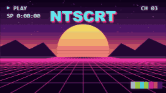<br><b>Clean CRT</b><br><sub>Downscaled to 256 px (Smooth); NTSC signal off; CRT Glow (Gaussian).</sub></td>
<td width="350" valign="top">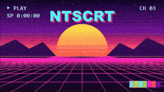<br><b>Clean VHS</b><br><sub>Downscaled to 320 px (Smooth); VHS LP; head switching, tracking noise, ringing, composite/luma/chroma noise, edge wave; no CRT shader.</sub></td>
</tr>
<tr>
<td width="350" valign="top">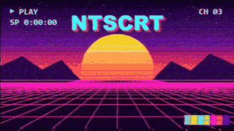<br><b>Gentle waves loop</b><br><sub>Downscaled to 320 px (Smooth); VHS SP; head switching, ringing, composite/luma/chroma noise, edge wave; CRT Glow (Gaussian).</sub></td>
<td width="350" valign="top"><br><b>High Chroma static</b><br><sub>Downscaled to 256 px (Chunky); VHS EP; head switching, tracking noise, composite noise, edge wave; CRT Glow (Gaussian).</sub></td>
</tr>
<tr>
<td width="350" valign="top">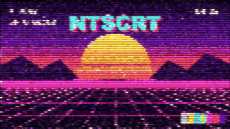<br><b>Low Res</b><br><sub>Downscaled to 128 px (Chunky); VHS LP; head switching, tracking noise, ringing, composite/luma/chroma noise, edge wave; CRT Glow (Gaussian).</sub></td>
<td width="350" valign="top">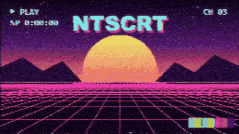<br><b>Medium VHS</b><br><sub>Downscaled to 256 px (Chunky); VHS EP; head switching, tracking noise, ringing, composite/luma/chroma noise, edge wave; CRT Glow (Gaussian).</sub></td>
</tr>
<tr>
<td width="350" valign="top">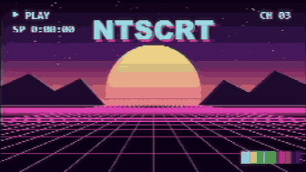<br><b>Mild VHS</b><br><sub>Downscaled to 256 px (Chunky); VHS SP; CRT Glow (Gaussian).</sub></td>
<td width="350" valign="top">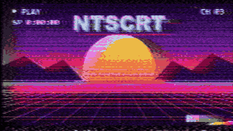<br><b>Obliterated</b><br><sub>Downscaled to 256 px (Chunky); VHS LP; head switching, tracking noise, ringing, composite/luma/chroma noise, edge wave; CRT Glow (Gaussian).</sub></td>
</tr>
<tr>
<td width="350" valign="top">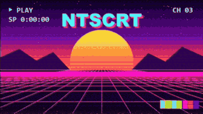<br><b>Readable Text</b><br><sub>Downscaled to 384 px (Smooth); VHS SP; head switching, tracking noise, ringing, composite/luma/chroma noise, edge wave; CRT Glow (Lanczos).</sub></td>
<td width="350" valign="top">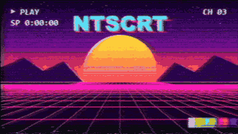<br><b>Wavy loop</b><br><sub>Downscaled to 320 px (Smooth); VHS LP; head switching, tracking noise, ringing, composite/luma/chroma noise, edge wave; CRT Glow (Gaussian).</sub></td>
</tr>
<tr>
<td width="350" valign="top">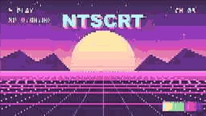<br><b>Webcam (low quality)</b><br><sub>Downscaled to 256 px (Smooth); NTSC signal off; Digital video (DCT (MPEG, DV) codec, 30 fps); no CRT shader.</sub></td>
<td width="350" valign="top">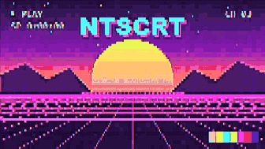<br><b>CD-ROM (low quality)</b><br><sub>Downscaled to 240 px (Chunky); NTSC signal off; Digital video (Block colors (Video 1) codec, 12 fps); no CRT shader.</sub></td>
</tr>
<tr>
<td width="350" valign="top">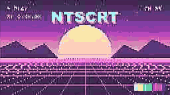<br><b>Chunky webcam</b><br><sub>Downscaled to 256 px (Smooth); NTSC signal off; Digital video (DCT (MPEG, DV) codec, 30 fps); no CRT shader.</sub></td>
<td width="350" valign="top">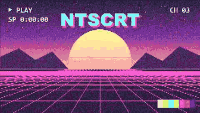<br><b>Cheap camcorder</b><br><sub>Downscaled to 480 px (Smooth); NTSC signal off; Digital video (DCT (MPEG, DV) codec, 29.0957 fps); no CRT shader.</sub></td>
</tr>
</table>

## Animated looks

These looks carry timeline keys: choosing one in **Presets → Preset** writes keyframes, one pass of the timeline from the effect's first frame, repeated until the effect ends. Each GIF shows one pass. (16 presets)

<table>
<tr>
<td width="350" valign="top">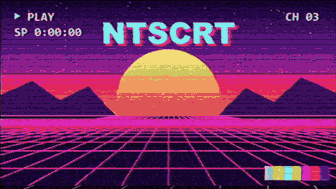<br><b>15 second glitches</b><br><sub><b>Animated</b> (2 s pass, 26 keys: Horizontal intensity, Chroma distortion chroma phase noise, Composite signal sharpening, Lowpass filter type and 16 more). Downscaled to 640 px (Smooth); VHS SP; head switching, ringing, composite/luma/chroma noise, edge wave; CRT Glow (Gaussian).</sub></td>
<td width="350" valign="top">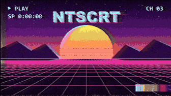<br><b>5 second blips</b><br><sub><b>Animated</b> (5 s pass, 16 keys: Horizontal intensity, Composite signal noise intensity, Composite signal sharpening, Vertical intensity and 17 more). Downscaled to 640 px (Smooth); VHS EP; head switching, tracking noise, ringing, composite/luma/chroma noise, edge wave; glitch: ghost; no CRT shader.</sub><br><sub><i>5 s pass; the scene's own 2 s loop jumps where the GIF restarts.</i></sub></td>
</tr>
<tr>
<td width="350" valign="top">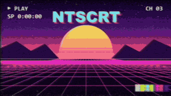<br><b>5 second glitch</b><br><sub><b>Animated</b> (2 s pass, 9 keys: Chroma distortion chroma phase noise, VHS emulation chroma loss, Tape crinkle, Reception ghost delay and 11 more). Downscaled to 384 px (Smooth); VHS EP; head switching, tracking noise, ringing, composite/luma/chroma noise, edge wave; CRT Glow (Gaussian).</sub></td>
<td width="350" valign="top">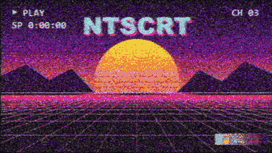<br><b>5 seconds mild glitch</b><br><sub><b>Animated</b> (2 s pass, 15 keys: Horizontal intensity, Chroma distortion chroma delay (horizontal), Chroma distortion chroma delay (vertical), Chroma distortion chroma phase noise and 21 more). Downscaled to 640 px (Smooth); VHS SP; tracking noise, ringing, composite noise, edge wave; glitch: ghost, vertical hold; CRT Glow (Gaussian).</sub></td>
</tr>
<tr>
<td width="350" valign="top">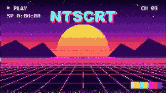<br><b>Glitch 1</b><br><sub><b>Animated</b> (2 s pass, 9 keys: Horizontal intensity, Chroma noise frequency, Chroma distortion chroma phase error, Chroma distortion chroma phase noise and 16 more). Downscaled to 256 px (Chunky); VHS SP; head switching, tracking noise, ringing, luma/chroma noise, edge wave; CRT Glow (Lanczos).</sub></td>
<td width="350" valign="top">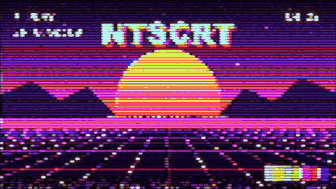<br><b>Glitch 2</b><br><sub><b>Animated</b> (2 s pass, 10 keys: Horizontal intensity, Composite signal noise, Composite signal noise detail, Composite signal noise frequency and 13 more). Downscaled to 128 px (Chunky); VHS EP; head switching, tracking noise, ringing, composite/luma/chroma noise, edge wave; CRT Glow (Lanczos).</sub></td>
</tr>
<tr>
<td width="350" valign="top">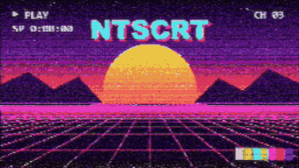<br><b>Glitch loop 1</b><br><sub><b>Animated</b> (2 s pass, 7 keys: Horizontal intensity, Vertical intensity, CRT Glow (Lanczos) color Boost, CRT Glow (Lanczos) monitor Gamma and 4 more). Downscaled to 256 px (Chunky); VHS LP; head switching, tracking noise, ringing, composite/luma/chroma noise, edge wave; CRT Glow (Gaussian).</sub></td>
<td width="350" valign="top">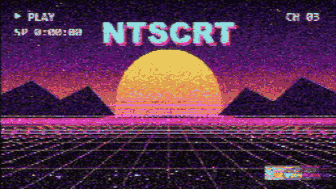<br><b>Glitch pop</b><br><sub><b>Animated</b> (2 s pass, 11 keys: Horizontal intensity, Composite signal sharpening, Ringing, Vertical intensity and 11 more). Downscaled to 256 px (Chunky); VHS SP; tracking noise, ringing, composite noise, edge wave; CRT Glow (Gaussian).</sub></td>
</tr>
<tr>
<td width="350" valign="top">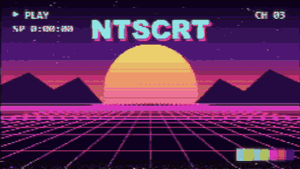<br><b>Gltch 3</b><br><sub><b>Animated</b> (2 s pass, 10 keys: Horizontal intensity, Chroma distortion chroma delay (horizontal), Chroma distortion chroma delay (vertical), Chroma noise and 21 more). Downscaled to 256 px (Chunky); VHS LP; head switching, tracking noise, ringing, composite/luma/chroma noise, edge wave; CRT Glow (Gaussian).</sub></td>
<td width="350" valign="top">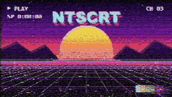<br><b>Static loop 1</b><br><sub><b>Animated</b> (2 s pass, 8 keys: Horizontal intensity, Composite signal sharpening, Vertical intensity, VHS emulation chroma loss and 1 more). Downscaled to 256 px (Chunky); VHS SP; head switching, tracking noise, ringing, composite/luma/chroma noise, edge wave; CRT Glow (Gaussian).</sub></td>
</tr>
<tr>
<td width="350" valign="top">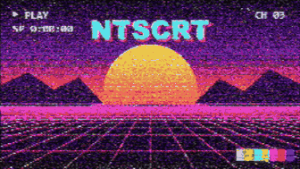<br><b>Tracking Noise up</b><br><sub><b>Animated</b> (2 s pass, 10 keys: Horizontal intensity, Composite signal noise intensity, Head switching height, Tracking noise height and 11 more). Downscaled to 256 px (Chunky); VHS LP; head switching, tracking noise, ringing, composite/luma/chroma noise, edge wave; CRT Glow (Gaussian).</sub></td>
<td width="350" valign="top">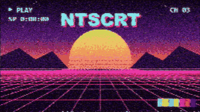<br><b>Two blips loop</b><br><sub><b>Animated</b> (2 s pass, 8 keys: Horizontal intensity, Vertical intensity, VHS emulation chroma loss, Edge wave intensity and 9 more). Downscaled to 256 px (Chunky); VHS EP; head switching, tracking noise, composite noise, edge wave; CRT Glow (Gaussian).</sub></td>
</tr>
<tr>
<td width="350" valign="top">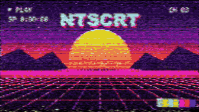<br><b>V Hold glitch</b><br><sub><b>Animated</b> (2 s pass, 8 keys: Reception aFC response, Tape crinkle, Tape dropouts, Tape head clog and 12 more). Downscaled to 192 px (Chunky); VHS LP; head switching, tracking noise, ringing, composite/luma/chroma noise, edge wave; glitch: tape crinkle, dropouts, ghost delay, head clog, head switching (+3); CRT Glow (Gaussian).</sub></td>
<td width="350" valign="top">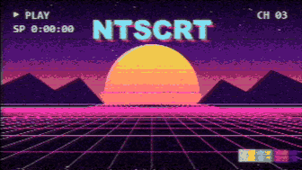<br><b>Vertical Freak Out</b><br><sub><b>Animated</b> (2 s pass, 6 keys: Tape head clog, Reception horizontal hold, Reception vertical hold, CRT Glow (Lanczos) color Boost and 5 more). Downscaled to 320 px (Chunky); VHS EP; head switching, tracking noise, ringing, composite/luma/chroma noise, edge wave; glitch: head clog, horizontal hold, vertical hold; CRT Glow (Gaussian).</sub></td>
</tr>
<tr>
<td width="350" valign="top">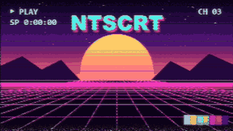<br><b>Vertical spike loop</b><br><sub><b>Animated</b> (2 s pass, 6 keys: Horizontal intensity, Chroma distortion chroma delay (horizontal), Chroma distortion chroma delay (vertical), Vertical intensity and 6 more). Downscaled to 320 px (Chunky); VHS SP; head switching, tracking noise, ringing, composite/luma/chroma noise, edge wave; CRT Glow (Gaussian).</sub></td>
<td width="350" valign="top"><br><b>Very wavy</b><br><sub><b>Animated</b> (2 s pass, 5 keys: Horizontal intensity, Edge wave intensity, Edge wave detail, Edge wave frequency and 7 more). Downscaled to 320 px (Smooth); VHS LP; head switching, tracking noise, ringing, composite/luma/chroma noise, edge wave; CRT Glow (Gaussian).</sub></td>
</tr>
</table>

## Digital video formats

Entries named `Digital video/<format>` in **Presets → Preset**: they turn on the Digital video stage (a digital camera and codec instead of tape) and set its values and the width; the rest of the look stays as it was (here: the default look). The descriptions are the formats' own. (6 presets)

<table>
<tr>
<td width="350" valign="top">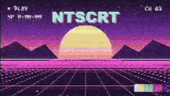<br><b>Digital video/Webcam (2005)</b><br><sub>320 × 240, 15 fps, a noisy sensor, each frame compressed on its own.</sub></td>
<td width="350" valign="top">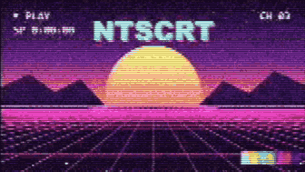<br><b>Digital video/Video call</b><br><sub>A squeezed bitrate and lost packets that smear until the next keyframe.</sub></td>
</tr>
<tr>
<td width="350" valign="top">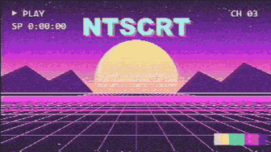<br><b>Digital video/MiniDV</b><br><sub>The VX1000 skate-video look: one field line-doubled, hard sharpening, aliasing and color moiré, blown highlights, warm saturated color, gray blacks, color at a quarter width (4:1:1).</sub></td>
<td width="350" valign="top">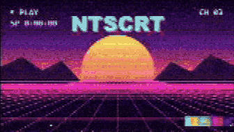<br><b>Digital video/Early web video</b><br><sub>240p streaming: few bits, coarse blocks, and keyframes that pump.</sub></td>
</tr>
<tr>
<td width="350" valign="top">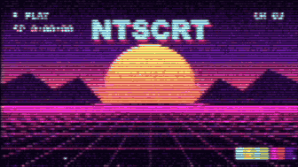<br><b>Digital video/CD-ROM (Video 1)</b><br><sub>Video for Windows off a 90s CD-ROM: 240 wide, 12 fps, Microsoft Video 1's flat two-tone blocks and banded 15-bit color, a keyframe every 15 frames.</sub></td>
<td width="350" valign="top"><br><b>Digital video/Datamosh</b><br><sub>Keyframes removed: motion drags the old picture around.</sub></td>
</tr>
</table>

## Screen Loop

**Presets → Screen Loop preset**: video feedback, a camcorder filming the TV that shows its own picture. These set only the Screen Loop controls (here over the default look). Each GIF shows the preset's Length: one move. (5 presets)

<table>
<tr>
<td width="350" valign="top">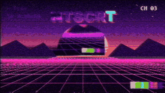<br><b>Screen Loop/12 copies luma key</b><br><sub>Length 5 s; delay 5, zoom 0.634, side angle 4.16, drift left – right 0.0487, handheld 0.4, luma key 0.464, key the dark parts, hue drift 15.9, color drift -0.489, seamless loop.</sub><br><sub><i>5 s pass; the scene's own 2 s loop jumps where the GIF restarts.</i></sub></td>
<td width="350" valign="top">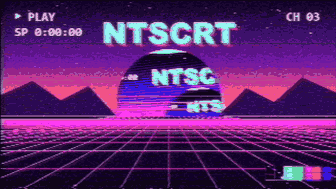<br><b>Screen Loop/15 copies color drift</b><br><sub>Length 2 s; delay 6, zoom 0.712, side angle 4.16, drift left – right 0.0245, drift up – down -0.448, handheld 0.4, luma key 0.579, key the dark parts, hue drift 14.1, seamless loop.</sub></td>
</tr>
<tr>
<td width="350" valign="top">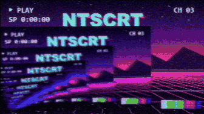<br><b>Screen Loop/22 copies bottom left</b><br><sub>Length 5 s; delay 4, zoom 0.733, side angle -4, drift left – right 0.348, drift up – down -0.296, handheld 0.4, color drift -0.3.</sub><br><sub><i>5 s pass; the scene's own 2 s loop jumps where the GIF restarts. One-way move: it starts over where the GIF restarts.</i></sub></td>
<td width="350" valign="top">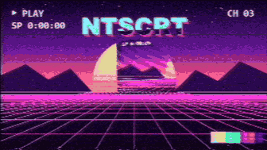<br><b>Screen Loop/7 copies slow luma</b><br><sub>Length 2 s; delay 6, zoom 0.537, side angle 4.16, drift left – right -0.123, drift up – down 0.0129, handheld 0.4, luma key 0.579, key the dark parts, seamless loop.</sub></td>
</tr>
<tr>
<td width="350" valign="top">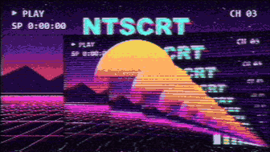<br><b>Screen Loop/Bottom to top</b><br><sub>Length 5 s; delay 6, zoom 0.757, side angle 4.16, drift left – right 0.00586, drift up – down -0.983, handheld 0.0391, luma key 0.307.</sub><br><sub><i>5 s pass; the scene's own 2 s loop jumps where the GIF restarts. One-way move: it starts over where the GIF restarts.</i></sub></td>
<td width="350"></td>
</tr>
</table>

## CRT shaders

**CRT → Shader**: the libretro slang CRT shaders over the default look (which uses CRT Glow (Gaussian)). Best seen at full size: the GIFs are scaled down, so the masks and scanlines blur. (7 presets)

<table>
<tr>
<td width="350" valign="top"><br><b>CRT Aperture</b><br><sub><code>aperture</code>: libretro <code>crt/crt-aperture.slangp</code> over the default look.</sub></td>
<td width="350" valign="top"><br><b>CRT Easymode</b><br><sub><code>easymode</code>: libretro <code>crt/crt-easymode.slangp</code> over the default look.</sub></td>
</tr>
<tr>
<td width="350" valign="top">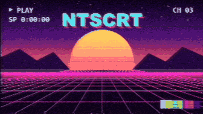<br><b>CRT Glow (Gaussian)</b><br><sub><code>glow_gauss</code>: libretro <code>crt/crtglow_gauss.slangp</code> over the default look. This is the default look's shader.</sub></td>
<td width="350" valign="top"><br><b>CRT Glow (Lanczos)</b><br><sub><code>glow_lanczos</code>: libretro <code>crt/crtglow_lanczos.slangp</code> over the default look.</sub></td>
</tr>
<tr>
<td width="350" valign="top">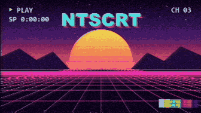<br><b>CRT Hyllian</b><br><sub><code>hyllian</code>: libretro <code>crt/crt-hyllian.slangp</code> over the default look.</sub></td>
<td width="350" valign="top"><br><b>CRT Royale</b><br><sub><code>royale</code>: libretro <code>crt/crt-royale.slangp</code> over the default look.</sub></td>
</tr>
<tr>
<td width="350" valign="top">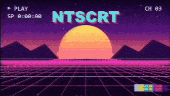<br><b>CRT Sim</b><br><sub><code>sim</code>: libretro <code>crt/crtsim.slangp</code> over the default look.</sub></td>
<td width="350"></td>
</tr>
</table>

---

### How these images were made

The scene is drawn by `scripts/make_previews.ps1 -SceneOnly` (no third-party footage). Each preset was rendered at 960×540 at 30 fps from frame 0, then every 3rd frame was encoded as a 10 fps GIF (every 5th frame, 6 fps, for passes longer than 2 s; 336×189, a 32-colour palette per GIF, ffmpeg palettegen/paletteuse). Every group was rendered with the OpenFX plug-in in DaVinci Resolve Studio (headless), the preset chosen from its menu.

Every preset was checked against `ntscrt-cli` given the preset file (`--timeline` for the animated ones, `--feedback` for Screen Loop) on the first, middle and last frame: largest mean difference 1.90 of 255.

Regenerate the GIFs and this page (Resolve Studio closed, ffmpeg on PATH; `--renderer cli` renders without Resolve):

```
python scripts/make_presets_gallery.py --build <your CMake build dir>
```

New presets in `presets/`, new Digital video formats and new CRT shaders in `core/params/schema.json` are picked up automatically.
